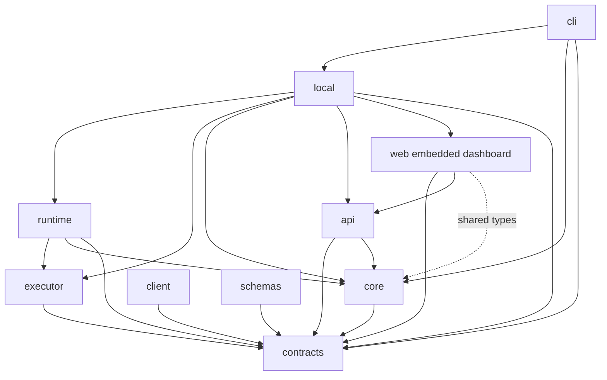
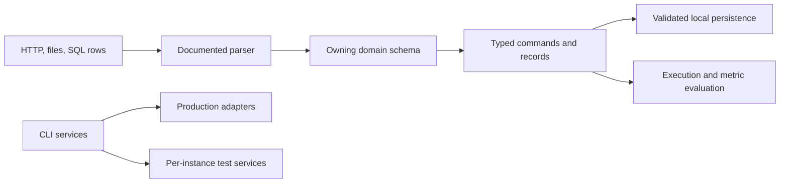

# Package architecture

Attest separates domain logic from execution and local application state. Package ownership follows what a caller needs to do. A hosted application can evaluate agents without importing a loopback server, a project directory, or Commander.

## Domain and protocols

`@attest/contracts` defines the versioned data exchanged with agents, metrics, projects, and machine clients. Native Effect 4.1.2 schemas own these types. Validate untyped input when it enters the system; typed application code should use the resulting discriminated unions directly.

`@attest/core` owns run records and storage interfaces, comparison rules, tabular import transformations, trace conversion, and case selection. The core `selectCases` function applies case/tag/folder/dataset
filters and seeded sampling before runtime scheduling. Contracts own selection schemas; local
expands authored cases and freezes the selected identities and coverage in each run. Core owns
partial-run comparison rules. It does not open databases, spawn processes, call providers, or start HTTP servers. Synchronous content hashing uses the standard crypto implementation. Core is reusable on compatible server runtimes; the browser imports only the types it needs. The browser-safe `@attest/core/analytics` entry folds case results into eval slice totals and run summaries.

Storage interfaces describe existing operations, not a proposed cloud repository framework. Keep durable records independent of the SQLite implementation so another host can implement the same operations when it has a concrete need.

## Execution

`@attest/executor` invokes agents through CLI, HTTP, streaming, persistent sessions, and Vercel Sandbox. It owns invocation retries, transport deadlines, output limits, process cleanup, and case environments. It imports contracts, never runtime, core, local, or CLI. Its compiled ESM runs on Node 22+ and Bun 1.4+.

`@attest/client` is the agent side of the callback transport, hosted by the consumer next to its agent. It accepts a trigger, runs a handler and posts the `attest.agent-completion`. It imports contracts and portable Effect modules directly. It never imports evaluator packages, so hosted agents do not install them. The root entry is a Web-standard `fetch` handler with no Node imports (ESLint enforces this) and runs on Node, Bun and Workers. `/node` adds the `node:http` server and workspace artifact collection; `/pi` drives `pi --mode rpc`.

`@attest/runtime` evaluates metrics and schedules evaluation cases. It owns eval lifecycle hooks and case environment lifetime, and imports executor for invocation types. An `EvalCaseRunner` awaits stage callbacks between agent work and evaluation. Ordered hook arrays and injected environment factories let applications add behavior without replacing the scheduler. Runtime receives persistence and artifact behavior through the existing evaluation interfaces.

Runtime must not import local or CLI. A hosted worker can supply its own persistence and resource setup while retaining the same execution rules. A process-based agent still requires a host capable of running processes; package separation does not make it executable inside a Cloudflare Worker.

## Local application

`@attest/local` discovers and loads project files, applies transactional resource changes, resolves local execution configuration, records runs in SQLite, writes artifacts, and serves the dashboard on loopback. It composes core and runtime with the filesystem and database. The dashboard's `RunControl` spawns the running `attest` CLI as a detached child process for each run and cancels through the eval cancellation registry. That is a process boundary, not an import of the CLI package.

Application errors carry typed codes and context. The CLI owns terminal rendering and exit presentation. Local must not import Commander or the CLI package. Paths, locks, cancellation registries, and the SQLite driver stay here rather than leaking into core types.

Local exposes focused entry points: `/agent`, `/metric`, `/test`, `/project`, `/eval`, `/runs`, `/store`, `/registry`, `/cloud`, and `/view-server`. Its root exports application errors and result types. `/registry` owns the global project registry under `~/.attest`; the view server reads its catalog rather than one store path.

`@attest/cli` translates flags and interactive answers into application requests. Its public entry point runs the CLI. It is not the SDK for project loading, eval execution, or persistence.

## Read and run control API

`@attest/api` owns the read contract, the run control contract, fetch server app, typed client and dashboard bootstrap injection. Hosts inject core's read-only `RunSource` through a `ProjectCatalog`, which lists projects and opens the run source of one project key. A host that can run evals also injects core's `RunControl`, which lists a project's tests, starts a run and cancels one. Without it the control routes answer `CONTROL_UNAVAILABLE` and the bootstrap reports `capabilities.control: false`; the cloud host and static reports inject none. An HTTP bootstrap also names its `host` (`local` or `cloud`), because a local host without run control reports the same capabilities as the cloud host. Every API route is project scoped; an unknown key fails with `PROJECT_NOT_FOUND`. API and web import the public decoder directly from browser-safe `@attest/contracts`. The package owns no storage driver, socket, process spawning, authentication or tenant policy. Contract and client subpaths use browser-safe core records. The server imports core's root for comparisons and store errors, so Cloudflare Workers hosts need `nodejs_compat`.

## Browser and artifacts

`@attest/web` supplies the same dashboard for the live local server and static reports. Web imports its client from `@attest/api/client`, parses bootstrap data through `@attest/api/contract`, and imports domain types from core. Dashboard routes use hash history so file-based reports can link to runs, cases and comparisons without a server rewrite. `/` indexes every project in the catalog, and the remaining routes start with `/projects/$projectKey`. Browser code must not import runtime, local, CLI, or Node modules. The browser-safe
`@attest/core/records` entry point exposes record, summary and comparison schemas
without importing persistence, hashing or execution code. Servers and browsers
validate their shared response projections through these owner schemas.

`@attest/schemas` publishes generated JSON Schema files. Its validation command checks both the file set and exact content against contracts. `@attest/site` remains a separate marketing page with no application dependencies.

## Cloud integration

Add cloud code where the deployment needs it. Reuse contracts and core; use runtime in execution workers with the necessary process or network capabilities. Implement storage and artifact adapters against actual cloud services. Do not import local to obtain a domain type or a comparison function.

Authentication, tenant boundaries, queues, and object storage belong to that deployment. They are not hidden inside the local dashboard server. The public local `/cloud` adapter owns the HTTP client, CLI credential storage, project links, and transactional project synchronization. CLI commands own flags and terminal output. The hosted service implementation stays outside the public repository.

## Checking boundaries

ESLint rejects runtime/application dependencies in executor, any attest import other than contracts in client, Node imports in the client root entry, execution and local infrastructure imports in core, local or CLI imports in runtime, CLI or Commander imports in local, and server imports in web. Workspace manifests and TypeScript references make the dependency graph explicit. Run the root build, typecheck, lint, and tests after moving an API across packages.

Executor APIs such as `invokeAgent`, transport sessions, and process cleanup are imported from `@attest/executor`. Runtime does not re-export them. Consumers using their former runtime exports must update imports and add the executor dependency. `CaseExecution` is imported from `@attest/runtime`, which assembles it from invocation results.

## Portable projects

`PortableProjectBundle` carries the existing `ProjectResources` snapshot plus UTF-8 authored
files. `resolvePortableProject` checks source/resource equality and manifest hashes before a host
persists a revision. Paths are limited to the canonical `attest.project.json` and `attest/` layout;
extra source files belong under `attest/metrics/code/`. Bundles allow at most 100 files, 1 MiB per
file and 5 MiB total. Credential-bearing HTTP fields require environment secret references.
Arbitrary dataset text and source code are user content; these checks do not detect embedded
secrets in arbitrary strings. Static source checks reject direct third-party and relative imports. TypeScript accepts node-prefixed
built-ins and bun; Python accepts the documented safe standard-library subset in
`portable-metric-source.ts`. These checks are a convenience preflight. They do not prove dependency closure and are not a security boundary. Sandbox isolation and runtime import errors remain authoritative. Hosts must return actionable metric errors for missing dependencies.
Cloud capability validation must reject unsupported execution hooks before accepting a run.

Core owns pure `resolveEvalRun`, dataset expansion, metric overrides, and canonical project
hashing. Local supplies loaded resources and maps domain errors into its application errors.
Cloud resolves the same resources from a validated bundle. Authentication, service response
envelopes, queue persistence, quotas, and retention remain deployment-owned.

Cloud revision identity must include the full bundle, including metric source bytes. The core
`projectHash` intentionally retains local manifest semantics and does not identify bundled source
files. Persist a full-bundle content hash and revision ID in cloud run provenance.

## Hosted transport injection

`@attest/executor/http` exports HTTP-only invocation and host transport hooks.
It does not eagerly import process or sandbox implementations. Hosted callers
supply guarded fetch through `createFetchHttpTransports` and set `retries: 0` for
mapped and streaming invocations. Native `invokeNativeHttpAgent` always records
one validated attempt. The host owns DNS pinning and tenant endpoint policy;
shared adapters own mapping, polling, stream parsing, caps and cancellation.
Workers using this entry point require `nodejs_compat` for crypto, util and Buffer.

`evaluateMetrics` accepts `exec.commandTransport` to execute custom commands in
a host-owned isolated environment. The transport receives the existing metric
request JSON and normalized timeout, output cap and cancellation options. It
returns bounded response text or a typed metric error. Runtime retains result
contract validation and scoring. The local command implementation loads only
when no custom command transport is supplied.

## Strict lint and boundary ownership

All 18 generic anti-slop rules run as ESLint errors. Vendored provenance,
licenses, and the narrowly documented boundary exception are recorded in
`tools/anti-slop/UPSTREAM.md`. Ordinary code uses owned contracts. A directly
attached boundary comment preserves unknown inputs only where a parser checks
untrusted representations.

Core owns the stored execution and evaluation schemas through its browser-safe
`@attest/core/records` entry point. Local validates records before database writes
and validates hydrated rows before returning them. Undefined optional fields are
normalized before schema parsing. Runtime owns the judge outcome schema. CLI decodes response contracts after bounded JSON parsing. The read API contract owns live response and static snapshot validation.

CLI services and sandbox invocation accept per-instance dependencies with the
production implementations as defaults. Tests supply those dependencies rather
than replacing modules globally.

Metric cancellation retains timeout source signals while the composed signal is
live. This avoids Node 22.15 garbage collection losing a deadline before process
cleanup. Source references release when the combined signal aborts or is collected;
subprocess GC tests cover timeout-only and caller-plus-timeout paths.

Release tooling validates the package fields it uses while preserving all other
JSON metadata. Packed archives retain npm binary mappings, and packing verifies
that each declared binary target is present.

## Dashboard storage projections, schema v2

Core owns dashboard DTO schemas in `@attest/core/records`, planned selection
identity derivation in `deriveSelectedCases` and strict live decoding in `plannedCaseSelection`, and the pure slice helpers in
`@attest/core/analytics`. RunSource adds eval pages, eval run/trend pages, stored
case windows, case history, UTC activity and run suites.

Local schema v2 freezes case verdicts and run creation order and maintains one
totals row per run/eval in the case transaction. Identical replay returns before
updates; conflicts and child insert failures roll back every projection.
Finalization materializes slice state before terminal immutability takes effect.
A complete slice needs known positive planned coverage, all planned cases recorded,
and no errors or skipped rows. A failed multi-eval run can contain complete slices.
Unknown historical plans remain incomplete with null pass rate and unknown failing state. Zero-selected eval slices are omitted. Only attest.eval-run schema identities enter eval discovery, windows, history and activity; generic run suites and summaries retain probe and legacy evidence.
Over-recorded plans fail rather than hiding a negative not-run count.

The eval/state/time index makes latest-complete lookup independent of incomplete
history length. Eval discovery pages a persisted eval catalog and uses indexed correlated latest/state seeks in one statement. Metadata hydration is batched with one JSON parameter. Pages use limit plus one,
never exact history counts. Stored case identity pages precede the ten-run outcome
window, so each page loads at most 1,000 identities and 10,000 cells. An opaque, bounded cursor carries the original ten run identities across pages; all recorded identities remain pageable. Null cells indicate absent evidence, not a selected case. Identities cover
recorded cases only; authored definitions and never-run cases belong to a separate
catalog. Activity uses UTC and visits at most 10,001 totals rows in a 92-day interval.
It returns at most 10,000 rows' contributions and an explicit truncation flag. When truncated it drops the entire boundary UTC day, including timestamp ties. Activity.coveredFrom and coveredTo identify the exact covered interval; clients must not fill older days as zero. It
counts eval slices rather than distinct multi-eval runs, and has no DST option.
Project overview returns a 500-eval page and at most 10,000 running run identities
through a partial index. Its eval cursor and running-count truncation flag must
remain visible to consumers. It never presents these lower bounds as exact totals.
The bulk outcome query explicitly pins a covering run/case index. Otherwise
SQLite can choose the history index and visit arbitrarily many older outcomes.

Migration v1 to v2 is a single offline BEGIN IMMEDIATE transaction including
backfill, trigger restoration and version publication. Backfill reuses the core
case projection rule, validates persisted records and decodes only historical plan fields, and
ignores stale v1 summary_json. A failure rolls back the whole version. It can
hold the write lock longer than another writer's five-second busy timeout. Stop
writers, back up the store and obtain human approval before applying to user data.
Do not split-commit this rebuild. The existing writer open applies migrations;
read-only registry and snapshot opens never migrate and report SCHEMA_OUTDATED.
No user store or remote migration was applied while developing v2.

Case and metric evidence updates/deletes are now rejected even during running
runs. Deleting runs with projection rows is consequently unsupported. This prevents
projection drift through cascading deletes. A future retention API must own an
atomic projection rebuild/decrement policy. Changes to verdict rules need a new
schema migration rebuilding both verdicts and totals; reads never repair them.
Same-process handles share a path lock to avoid synchronous SQLite busy waits
blocking another transaction's continuation. Cross-process serialization remains
SQLite-owned. Dashboard composite reads use deferred read transactions and one
WAL snapshot; they do not acquire writer reservations.

Dashboard migration corrections preserve historical config/evidence JSON and original run
creation timestamps. Canonical UTC `created_order` on runs and `run_created_at` on
case/totals projections own indexed ordering. RunRecord.createdAt and runs.created_at preserve the original live or historical timestamp, including offsets and fractional precision. Dashboard slice timestamps and query bounds use UTC milliseconds for the same instant. Clients join by run ID, never timestamp text. Bounds are
since-inclusive and until-exclusive. Backfill ignores today's effective command schema;
missing or unrecognized plan fields produce unknown coverage. Repeated historical tags
or test ids do not block migration. Contradictory case identities and evidence outside a known selection fail with typed CORRUPT_DATA identifying the run, suite and case. Secondary indexes
are built after backfill inside the same atomic transaction, before trigger restoration
and version publication.

Writer `openStore` currently migrates implicitly. Readonly opens reject v1. This is
not an implemented offline migration UX: a migration host must still obtain explicit
human approval, stop writers, back up the store, run the writer migration in an offline
window and verify readiness before reopening readers. No CLI command or guided host
integration is provided by this ownership chunk. Large stores can exceed busy_timeout;
real-store migration requires approval and an offline window. The v2 schema here is
unreleased; earlier disposable v2 fixtures must be recreated rather than reopened.

These measurements and JSON batching describe the local SQLite adapter. D1 needs its
own adapter and execution evidence under its 100-bound-parameter constraint; local
1,000-element IN queries are not evidence for that host. Dashboard metadata hydration and case-window outcome batches use JSON parameters rather than one parameter per item. Other local IN lists are not D1 execution proof. Project overview lastRunAt is the newest eval slice timestamp, not the newest run across all schemas.

Known selection is frozen atomically with run creation or v1 backfill. The runs.selection_known
marker distinguishes known empty selection from genuinely unknown historical coverage.
run_selected_cases has a primary key on run, suite and case; each new evidence write checks
that key without parsing config JSON or scanning the plan. Core derives counts and membership
from the same identities. Foreign suites, wrong cases and known zero participation reject live
writes as INVALID_RECORD and migration evidence as contextual CORRUPT_DATA. The case transaction
rolls back all evidence and projections. Identical stored replay still succeeds after finalization.
Invalid live configs reject before transactions; stored corruption remains CORRUPT_DATA.
Case-window cursor decoding catches only token failures. Database and hydration failures keep
their original classification. Empty registry activity uses the same bounds parser as SQLite.

Dashboard storage uses transactional per-suite totals and indexed bounded reads in local.
Core owns the projection schemas, exact selected-case derivation and synchronous eval analytics.
RunSource exposes native Effect reads with StoreError failures; a dashboard query shares one
SQLite read snapshot across its statements. The `attest web` command composes this catalog and
run control under the CLI application scope. Migration SQL and driver callbacks stay in local.

## Native Effect ownership

Operations return native Effect 4.1.2 programs with tagged errors. Pure domain
algorithms remain synchronous. Core storage and run-control contracts describe
Effect operations without importing local infrastructure. Executor owns transport
and process resources; runtime owns scheduling, metrics and case lifecycle. Local
composes those operations with project transactions, cancellation and persistence.
See [EFFECT.md](EFFECT.md) for cancellation and cleanup precedence.

The CLI runs one application program and captures its services before handing
commands to Commander. Its application scope joins admitted eval runs before store
release. `withStoreScope` owns concrete SQLite handles; stores and catalogs expose
native operations with captured dependencies. A returned event source or HTTP
request does not own an accepted run's lifetime.

API handlers, dashboard query callbacks and agent-client host callbacks execute
Effects only at the files and operations declared in ESLint's `effectRoots`.
The permanent boundary rule rejects execution elsewhere. The portable client owns
accepted handlers through runner shutdown; its Node and Pi integrations stay in
separate entry points. Foreign callbacks adapt individual operations at their host
boundary. Internal operations never create per-method runtimes.
