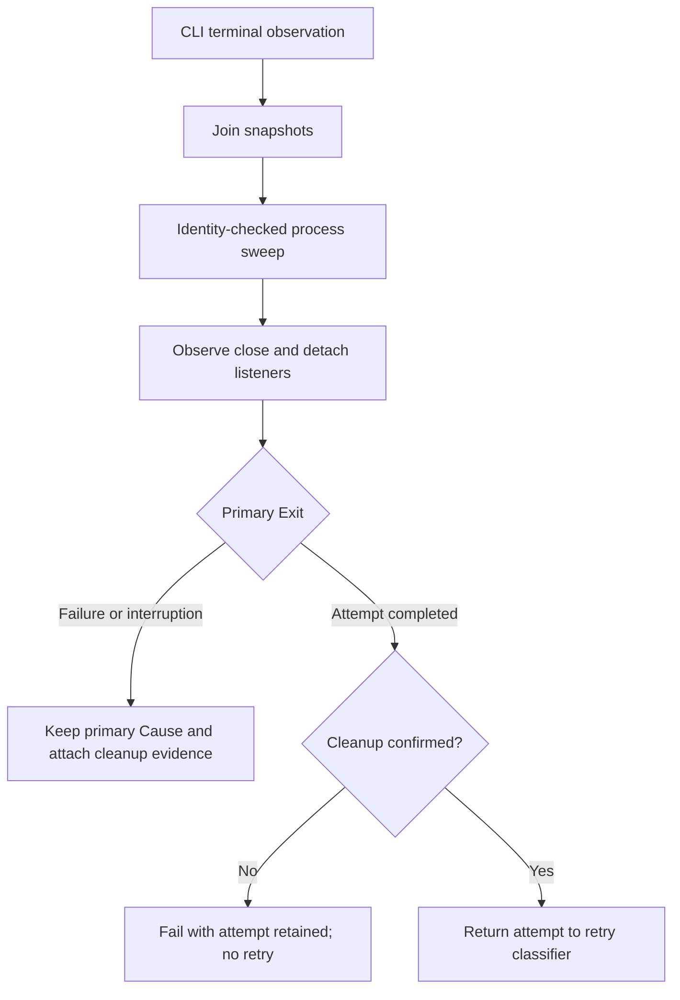
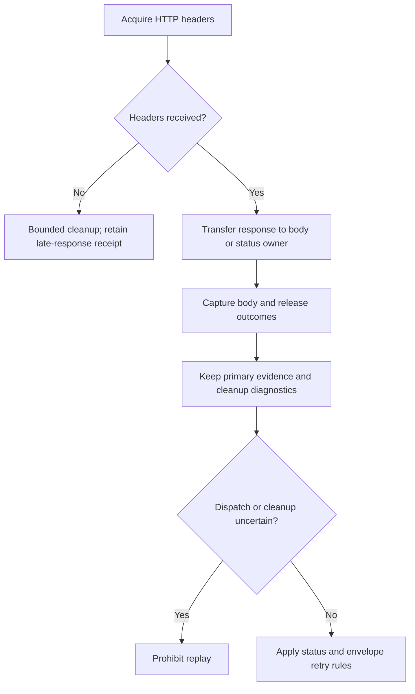

# Effect v4 in Attest

This guide governs the native Effect v4 migration. Claude Opus approved the architecture on 2026-11-06. Package ownership remains as documented in ARCHITECTURE.md; each implementation slice requires independent Sol, Claude Opus and Muse review before landing.

## Provenance

Adapted on 2026-11-06 from Hatim's consolidated guide, `/Users/hatim.shakir/.planloft/docs/loopy/loopy-effect-v4-patterns.md`, titled "Loopy Effect v4 coding patterns and architecture". Source SHA-256 at port time is `a2113f0aa664e128fea41f5e95cb6b3c7a31420a2871c30e201c451cadaa9b8b`. That guide identifies its research base as Loopy `33b50f26af0ae6205b5ac123f1e1a898fc9fce78` and supersedes its first proposal.

The retained corpus is `/Users/hatim.shakir/projects/loopy/effect-v4`, a symlink to `effect-v4-evidence-d5e4905`. `ARCHIVE.md` identifies the merged snapshot as `d5e4905340d05e7b4870f1ac5ce51d97b63374ee`. It is an evidence archive, not an active Git checkout. Relevant inputs are:

- `research/effect-v4/sol-sources.md` and `terra-sources.md`, with author pins and version limits.
- `research/effect-v4/deep/modules/findings.md`, for operation construction and transaction ownership.
- `research/effect-v4/deep/lifetimes/findings.md`, for interruption, cleanup and uncertain completion.
- `research/effect-v4/deep/contracts/findings.md`, for schema and transport behavior.
- `research/effect-v4/deep/probes/findings.md` and its installed `node_modules/effect/src`, for exact 4.1.2 signatures and bounded probe evidence.
- `.notes/effect-v4/coordination.md` and `contracts/migration.md`, for implementation lessons. Loopy's old delegation and review policy does not apply to Attest.

The third-party `sources/mattpocock--course-video-manager/docs/EFFECT_STANDARDS.md` is a v3 research input, not Hatim's guide. Matt's sampled code resolves to v3; Julius's gh-file-drop to v4 RC.109; Ben Davis's token-tracker to 4.0.2. They inform design, not 4.1.2 syntax. The consolidated guide reports 16 isolated probe tests and 52 assertions. Those are inherited Loopy evidence, not fresh Attest acceptance.

Target `effect` exactly `4.1.2`. The retained official source identifies [commit 506eef143bcc1750ce58920aac1e45da7265d103](https://github.com/Effect-TS/effect/tree/506eef143bcc1750ce58920aac1e45da7265d103). Installed probe source also reports 4.1.2 but differs in layout from the cached GitHub source. Verify the installed Attest distribution and lock integrity before implementation. Do not infer byte equality from matching versions. Verify peer requirements before adding any platform packages. Do not mix v3 platform packages into v4.

Loopy-specific graph language, atomic apply/outbox, Durable Object leases, daemon architecture and reviewer assignments have been removed. Attest keeps its own contracts, project journal, run records and package boundaries.

## What becomes Effect

An operation that reads files, stores records, invokes an agent, evaluates a remote metric, waits, schedules concurrent work or owns a resource returns `Effect.Effect<A, E, R>`. Expected operational failures belong in `E`. Required services belong in `R` until the composition root supplies them.

Pure case selection, seeded sampling, comparison classification, import transformations, analytics, canonicalization, assertions and result normalization remain synchronous. The I/O coordinator in `diffRuns` becomes Effect; the comparison algorithm does not. Synchronous hashes stay explicit in server-only owners. Do not make every function an Effect to satisfy a search count.

Replace owned async orchestration with generators and native concurrency. `Effect.tryPromise` wraps actual foreign SDK, fetch or driver calls, not an entire old Promise implementation. Delete the replaced path in the same slice. Keep a Promise only at an identified foreign boundary such as Hono, Commander, React's client adapter, the consumer's agent handler or an SDK callback.

## Operation modules and composition

Use Context.Service keys at composition roots for replaceable dependencies such as stores, catalogs and cancellation registries, not for every operation module. Infer the service shape from its constructor using `Effect.Success<typeof makeOperations>` where practical. Contracts that admit host implementations, such as `RunSource`, need explicit operation signatures with concrete error unions.

Capture dependencies once in an `Effect.gen` constructor. Use named `Effect.fn` operations for meaningful operations. Do not add a service per helper, one forwarding class per package, a global service locator or a parallel repository framework.

`Layer.effect(Key, make)` constructs an effectful service and scopes its acquisition. `Layer.succeed(Key, implementation)` supplies an already constructed value. Reuse the same database layer object within the application build. Two objects with one key can open two databases; separate runtime builds also acquire separately. `Layer.fresh` is not a fix for broken provisioning.

The CLI invocation owns one application scope. The local server owns its catalog, opened stores and listener until shutdown. Each evaluation owns worker environments and invocation sessions. Each HTTP request owns response reads and readers, but must not own a detached run admitted by `RunControl.startRun`. The agent client owns accepted invocations until drain/close. Static reports have no run-control layer.

Run Effects only at these entry points in the completed migration. During staging, an unmigrated Promise parent may call an Effect leaf through a lint-ledgered temporary bridge; the reverse direction is forbidden. A managed runtime, when needed for repeated foreign callbacks, has one explicit disposer. Do not call `runPromise` inside an already migrated Effect operation or create a runtime per database method.

## Errors and outcomes

Use `Data.TaggedError("Tag")<Fields>` for internal errors, or `Schema.TaggedError<Self>()("Tag", fields)` when the error itself needs a schema. Use tagged errors for failures that prevent an operation from delivering. Preserve the original cause and safe operation context. A persisted failed case, agent-reported failure, metric score and requested cancellation response remain domain data. They are not automatically Effect failures.

Keep invocation transport failures, metric failures, storage failures, project rejection, cleanup uncertainty and malformed input distinguishable. Preserve existing public error codes through exhaustive edge mappings. Never branch on message strings, use blanket `orDie`, or turn failed reads into missing records, empty lists or successful cancellation.

Broken invariants are defects. Interruption is a runtime cause. User cancellation, deadline expiry and transport disconnect are distinct events, even when all interrupt fibers. Do not translate every interrupted request into a persisted cancelled run.

Retain complete `Cause` information internally. Inspect reason tags and `Cause.hasInterrupts`; do not parse `Cause.pretty`. Define how a primary failure and cleanup failure determine the public result. Preserve invocation evidence and cleanup confirmation alongside that result. Owner tokens, credentials, raw Causes and database details must not enter public JSON or logs.

## Resource ownership and cancellation

Register release immediately after acquisition. Stop and join dependent fibers before closing their process, socket, environment or store. Use `Deferred` for a one-time handshake and `Queue` or generation tracking for repeated completions. Bound concurrency and queues explicitly. Queue capacity does not replace per-test caps, worker affinity or output limits.

The inspected installed signatures distinguish two brackets:

```ts
// Simplified signature shapes, not an additional Attest API.
acquireRelease(acquire, release /* returns Effect<unknown, never, R2> */);
// Acquisition adds Scope to the required environment.
acquireUseRelease(acquire, use, release /* may fail with E3 */);
// Returns Effect<A, E | E2 | E3, R | R2 | R3>.
```

Cleanup follows these rules rather than Effect's default cause combination:

- R1. Ordinary release/finalizer effects have `E = never` and capture cleanup failures, including foreign defects, as owned `CleanupFailure` diagnostics. They never throw or use `orDie`. Store diagnostics in the operation's result or its own Ref, with no global collector.
- R2. Choose the result from the primary Exit and recorded cleanup. A primary typed failure remains the public failure. A primary interruption remains interruption. Both retain cleanup diagnostics internally. After primary success, cleanup failure becomes the operation's typed error carrying success evidence, or explicit domain flags. Examples are `project_saved_cleanup_failed` with `committed: true` and transaction identity, or false cleanup/completion/ownership-release flags. A store close failure after a successful read still fails the operation.
- R3. Primary defects stay defects. Edges map them to the internal error code and retain a redacted Cause. Inspect reason tags and `Cause.hasInterrupts`, never rendered Cause text. Capturing a cleanup defect must not turn a primary defect into success.

Project rollback is a compensating durable mutation. If rollback or its journal cleanup fails after a typed transaction failure, return `project_recovery_required` with the transaction identity and retain both Causes internally. After confirmed restoration, preserve a domain error or map foreign failures to `project_transaction_failed` with the restored-state message and transaction identity. Primary defects and interruption keep their runtime Cause. Ordinary descriptor and lock releases still follow R1 through R3 above.

A fallible `acquireUseRelease` release is permitted only when it inspects the primary Exit and can fail solely after primary success, such as post-commit project cleanup. Otherwise use R1. Register cleanup immediately after acquisition and attempt every required cleanup step.

Bound uncooperative foreign cleanup with `Effect.timeoutOption(Effect.interruptible(cleanup), bound)` inside masked release. Capture its entire outcome into diagnostics. A timeout means cleanup is unconfirmed; it does not prove a process or sandbox stopped. Preserve process-tree termination, signal grace and descendant verification. Never reuse an environment with unconfirmed cleanup.

Cancellation and deadlines are business inputs. Represent each request as an `Effect<void>` backed by a Deferred. The owner keeps resources in an outer bracket, races only observation against cancellation/deadline, performs kill or close in normal flow, then returns cancelled or timeout evidence. `Effect.timeout`, `timeoutOption` and `raceFirst` must not surround operations that produce attempt, metric or case evidence. They may bound pure waits or cleanup. Observation must not interrupt a sibling case or discard its eventual evidence.

Reserve fiber interruption for teardown and shutdown. The first CLI SIGINT/SIGTERM completes business cancellation instead of interrupting the application root. Preserve once-only listeners so a second signal can terminate the process. Foreign SDKs receive the signal allocated by `tryPromise` with an ordinary declared `(signal) => ...` parameter, not rest/default parameters. Consume response bodies in the cancellable foreign operation. Remove owned AbortSignal.any composition and its retention helper only when the last consumer migrates, and update the architecture note in that slice.

`tryPromise` aborts and resumes on interruption without joining the foreign Promise. It does not prove completion or rollback. Reconcile uncertain writes by identity before any allowed retry.

Eval registry release uses the run's Exit. Unregister only when `Exit.isSuccess(exit)` and `exit.value.can_release_cancellation_ownership` are true, with the matching generation. Otherwise detach the poller and retain ownership evidence. Acquire the store before publishing the registry so registry release runs before store closure. Cancellation acknowledgement means requested, not stopped. Keep cancellation requests scoped to the run, never signal arbitrary work by PID alone.

The eval run forks into the CLI application scope with `forkIn`, not as a child of the action that returns its event queue. Join it before root disposal. A process-root CancellationRegistry service replaces the module-global controller map. Its run-local poller uses `forkScoped` with a 25 ms spaced schedule. Client invocations live in a runner-owned FiberSet, never the triggering request. Closing signals cancellation, allows bounded completion delivery/drain, then interrupts remaining work.

Detached dashboard admission is not tied to the HTTP request signal. It is uninterruptible but bounded by the existing start timeout plus stop grace. Preserve kill-tree verification and report an unconfirmed child explicitly. Never retry admission automatically. A new client request has a new run identity.

## Persistence and project transactions

Core owns native Effect storage contracts. Methods capture dependencies at construction and return Effect with `R = never`. Remove `close()` from RunStore and AttestStore; scoped constructors own closure. ProjectCatalog owns its opened readonly stores, and openProject exposes no Scope requirement. Do not cache failed opens. If RcMap is used, prove failed-open eviction with a gated test. Local owns SQLite/Kysely/libsql adapters, migrations, driver choice and closure. Retain readonly opens with no creating fallback. Keep row validation and transactional writes at the adapter boundary.

Inspect each driver's transaction contract separately. A synchronous SQL callback must finish synchronous SQL before returning; returning an Effect does not run it in the transaction. Wrap that whole foreign operation once. An asynchronous libsql/Kysely transaction must commit or roll back before releasing its connection. Do not copy Loopy's synchronous driver recipe onto all Attest drivers. Do not nest a runtime inside a transaction callback.

Store mutations wrap the complete Kysely transaction Promise in Effect.uninterruptible so a transaction cannot outlive handle closure. Its callback remains Kysely code, with no nested Effect runtime. Preserve StoreError and map other failures to WRITE_FAILED. Reads may remain interruptible. Registry publication/unregister and project journal commits are also uninterruptible.

Keep network calls and notification publication outside a database transaction. Preserve atomic case recording and aggregate updates. A lost commit acknowledgement is uncertain, not proof of rollback. Only recordCase may replay identical input bytes through its existing hash check. Preserve same-status finalize acknowledgement; never blindly retry createRun or finalizeRun.

Project changes retain lock ownership, expected-hash checking, staged journals, path rechecks, fsync and manifest-last publication. Dry-run remains write-free, including lock creation and journal recovery. Preserve the distinction between rolled-back failure, recovery required, and `project_saved_cleanup_failed` with `committed: true`. Do not repeat the mutation when only cleanup failed.

## Schema and wire policy

Use native Effect Schema as the owner and infer decoded/encoded types. No Zod-shaped facade and no permanent duplicate schema declarations. Convert all callers of an owned schema in the same compiling slice, including JSON Schema generation, CLI inputs, SQL rows and browser bootstrap consumers.

Export the contracts-owned decoder publicly from @attest/contracts in Result, Effect-error and synchronous throwing forms. These are the supported decoders for Attest schemas, including external consumers. The web router uses the sync-throwing form. S1.0 introduces these forms over the existing Zod owner with no behavior change; S1a replaces the implementation with native Effect Schema. Validate unknown input once through this owner and options `{ onExcessProperty: "error", errors: "all" }`. Ban direct Schema decode calls elsewhere by lint, except explicitly owned synchronous throwing edges routed through that decoder. Preserve public Attest Result and ParseReport pure-parser shapes; native Effect Result remains internal. Effect operations fail through E rather than returning the public Result envelope.

Contracts owns three struct constructors. Strict uses Schema.Struct. Loose uses StructWithRest with a string-to-unknown record to preserve extra keys. Strip decodes the loose representation into a plain struct, dropping extras. Map existing strict/loose/strip schemas one for one, including nested combinations. A tightening is a behavior change, never an incidental migration default. Prove these constructors against the installed 4.1.2 distribution before converting owners.

Map Zod optional to Schema.optional by default, preserving explicit undefined. Use optionalKey only when key presence matters. Preserve Object.hasOwn-based outcome rules. Accept readonly decoded types explicitly and rewrite mutation sites to construct values; parameters accept readonly arrays. Use mutableKey only where a foreign API requires mutation. Audit defaults, null, coercion, finite/integer checks, recursive JSON and refinements.

Replace the issue formatter with SchemaIssue formatting based on makeFormatterStandardSchemaV1 paths. Preserve `$` for root, dot joins and one issue path per unexpected key. Multi-path refinements use makeFilter returning path/issue arrays; agent-request fixture 04 must still report both turn_index and conversation_id. Authored refinement messages stay identical. Built-in display messages may change, with no message-based branching. Unknown-field warnings read the inner struct fields, and invalid optional trace still degrades to warnings.

Preserve protocol identifiers, public codes, field names, canonical hashes, project identity, selection counts, exactly-one output/error, callback trace/trace_ref exclusion and cursor semantics. Keep internal `_tag` out of public envelopes. Canonical bytes after decoding must match base fixtures.

Generate with toJsonSchemaDocument using `onExcessProperty: "error"`. Assemble dialect, root schema and definitions as `$defs` before existing invariant overlays. Keep Draft 2020-12, filenames, `$id` and overlay comments. Compare accepted/rejected fixture verdicts under AJV using both old and new artifacts as S1a evidence. The permanent exact generated-content check remains. Keyword placement, definitions names and equivalent representation may change; changed validation verdicts, lost required/excess-property rules or loosened constraints must be restored with annotations/overlays. No unreviewed wire break is permitted. AJV remains for user-supplied JSON Schema metrics.

S1.0 first centralizes schema decoding while still on Zod without changing behavior. S1a swaps the shared schema/composition closure atomically. S1b migrates private schemas per package. Check installed TanStack AI types before replacing the judge schema: use Effect-derived JSON Schema/Standard Schema if supported; otherwise retain its single Zod schema as a documented foreign SDK owner, with no duplicate schema. Web router params retain intentional synchronous throws through the decode owner, and validateSearch uses Standard Schema with explicit catch-to-default parity.

Public TypeScript operation APIs intentionally change to Effect. Update all repository consumers and document the break. Persisted data and agent/cloud wire formats need a concrete migration decision before changing. Backward compatibility shims are not the default.

## HTTP, streams and portability

Keep Hono and Commander at the first migration boundary. Native operations do not require replacing the web framework or CLI parser. Do not adopt HttpApi in this migration. Hono handlers run native operations with the request signal, except detached admission. The CLI owns one ManagedRuntime with one disposer.

Stream adapters retain incremental framing across arbitrary chunks, UTF-8 handling, caps, deadlines, terminal rules and raw evidence hashes. Scope reader cancellation and socket/session closure. Preserve event ordering, configured versus completion indices and run terminal event precedence. A Stream conversion does not itself prove backpressure, reconnect or delivery semantics.

Keep `@attest/core/records`, `/analytics`, API `/contract` and `/client` browser safe. `@attest/client` root remains Web-standard and imports no Node code or evaluator runtime; `/node` and `/pi` own process integration. Executor `/http` must not eagerly load process or sandbox implementations. Its documented hosted use still requires `nodejs_compat`.

Allow core `effect` imports only. Ban platform subpaths `effect/http`, `http-api`, `sql`, `process`, `cli`, `rpc`, `socket`, `cluster`, `workflow`, `ai`, `persistence` and `workers`. Only data-only entries core/records, core/analytics and api/contract are restricted to effect, effect/Schema, effect/SchemaIssue, effect/SchemaAST and effect/JsonSchema, plus explicitly documented core modules proven necessary by S0. api/client, web and the client root may import portable core Effect modules. All browser entries ban platform subpaths and Node built-ins. Record bundle sizes at S1a, S9a and S9c.

Track permanent execution roots in the `effectRoots` ESLint block and temporary forward bridges in `effectMigrationBridges`. Ban Effect.run* and ManagedRuntime.make elsewhere. Every temporary bridge carries an adjacent EFFECT-BRIDGE(Sx) tag and a ledger owner/removal slice. The lint-rules gate checks tags against listed files in both directions. S10 removes the temporary block and the typecheck-only tools/effect-probe workspace.

Server packages support Node 22.15+ and Bun 1.4+. Choose portable core Effect APIs first. Do not add Bun-only SQL/process implementations as defaults for Node. S0 measures node:sqlite import support, readonly opening of an existing fixture and rejection of a missing fixture without creating it on Bun 1.4; retain the explicit readonly error if unsupported. Keep Kysely, node:sqlite and libsql rather than switching SQL drivers. Existing process support does not become Worker-compatible through Effect. S1a records web bundle size before/after and updates the client dependency documentation from Zod to Effect. S9c measures the Workers client bundle. The consumer handler/fetch API stays Promise as a foreign boundary. Browser builds catch platform imports.

## Security and validation

Retain loopback binding, origin checks, callback tokens and duplicate admission keys, secret-reference resolution, redaction, bounded bodies/artifacts, pinned HTTP destinations and host-owned DNS/tenant policy. Retain path anchoring and symlink defenses, isolated child environments and argv-based hooks. Portable-source static checks remain preflight, never sandbox proof. Cloud full-bundle identity includes source bytes; local manifest hash does not substitute for revision identity.

Use isolated temporary projects, homes, stores and loopback port 0. Never use personal registries, real credentials, production databases, providers or deployments as migration fixtures. Mock evidence is not hosted acceptance.

Each slice must compile with its callers, satisfy lint/format and pass owned invariant tests. Test resource ordering, cancellation, rollback, schema conversion and durable uncertainty where they can fail. Keep tests in `_tests_`; avoid forwarding-wrapper tests. Run the root build, typecheck, lint, format and tests, plus affected schema, portability and CLI acceptance gates. Update `docs/SCRIPTS.md` for script changes and `docs/ENV.md` for environment or binding changes.

Before implementation, Claude Opus must approve the architecture. Every implemented slice then needs separate Sol, Claude Opus and OpenCode Muse Spark 1.3 Contributor approvals on a frozen exact diff. Any fix invalidates affected approvals until re-reviewed. No merge onto main with missing approval. Reviewer availability must be verified without substituting models silently. The local `PLAN.md` records ownership, gates and open decisions.

## S0 tooling ownership

`tools/effect-probe/src/probe.ts` is a typecheck-only consumer of exactly Effect
4.1.2. S10 deletes the workspace, root probe script and dependency entries. It does
not execute effects and needs no execution exception. No production roots or
bridges are declared in S0.

The local `effect-boundaries` lint rule freezes the installed root module export
list as its core allowlist. Nested and platform subpaths are rejected. Data-only
entries use exactly Schema, SchemaIssue, SchemaAST and JsonSchema, including named
imports from the root. No additional data modules were needed. Execution method
references, including named imports and aliases, require a declared operation in
an exact-file root or bridge entry. Namespace escapes and dynamic Effect loading
are rejected to keep ownership visible. Bridge entries carry `file`, `operations`, `owner` and a `bridges` list of
`{ operation, removalSlice, owner }` associations. One exact-file config block
preserves every association when a file has multiple removal owners. For example,
project-registry reads end in S2 and writes end in S8c. Each execution reference
needs an adjacent real `EFFECT-BRIDGE(Sx)` comment matching its operation's declared
association. Removal slices are limited to the approved migration plan; stale and
duplicate associations fail lint. The legacy single `removalSlice` rule option
remains covered by lint tests, but new ledger entries use associations. The lint-rules gate checks config routing, declaration
files, stale operations and unmatched tags. Neither tests nor browser entries get
a general execution exception.

Execution ownership also covers Runtime.makeRunMain, FiberSet/FiberMap/FiberHandle runtime and runtimePromise, and Stream.toReadableStream* / toAsyncIterable*. These APIs require exact operation ledger entries just like Effect.run*. A root keeps its ManagedRuntime value in its own file and never passes it to other modules; the lint rule does not track runtime instance methods across module boundaries.

## Public native decoder, S1a

`@attest/contracts` exports `parseWithSchema(schema, candidate)` returning the
public Attest `Result`, `parseWithSchemaEffect(schema, candidate)` returning a
native `Effect` with validation failures in E, and
`parseWithSchemaSync(schema, candidate)` for intentional synchronous throws.
Output types follow the schema, including transforms and generic schemas.
External consumers, including the future attest-cloud migration, must use these
exports instead of invoking schema parsing methods. No private repository was changed.

S1a replaces the former Zod definitions with native Effect Schema. This intentionally
breaks the public TypeScript schema API: infer decoded types with `typeof schema.Type`
and encoded types with `typeof schema.Encoded`. Decoded collections are readonly.
All three decoder forms use `SchemaDecodeError`, carrying the native SchemaError as
its cause and readonly issues with native structural tags, PropertyKey paths and
messages. Authored messages and public protocol paths remain; built-in wording and
union branch diagnostic multiplicity change. Consumers must not inspect Zod trees
or branch on messages. No stored-data migration is required.

The Effect form is suspended and fails with SchemaDecodeError in E. The synchronous
forms use the declared contracts decoder root. Thrown user refinements remain defects
in Effect and throw their original cause at synchronous boundaries. Existing protocol
parsers retain ContractIssue[] and ParseReport warning shapes through formatContractIssues.
Nested strict, loose and strip policies share error/all decoding; defaults and catch
behavior remain schema-owned. Manifest and reference invariants share pure checks
rather than decoding the same manifest again inside a parent refinement.

Typed lint rejects native Schema/SchemaParser decoder references and Schema.is/asserts
outside the owner. The temporary typecheck-only tools/effect-probe/src/probe.ts
also retains its direct upstream signature checks until S10 deletes it. No other
probe or test file receives this exception. Schema.decodeTo transformations and foreign Standard Schema adapters
remain allowed. Legacy Zod execution is also rejected. The intrinsic JSON guard in
project/shared.ts remains an owner exception. JSON, Date, Commander and router parsers
are unrelated and remain permitted. Reference checks do not track erased any or
arbitrary interprocedural data flow.

External attest-cloud consumers must migrate shared schema reflection and decoder
errors with S1a. Its later store, executor, metrics, runtime and API operation changes
remain separate slices. No private repository or hosted runtime was changed or verified.

Platform and companion `@effect/*` imports require an architecture decision.
Computed import and require paths are banned repo-wide so lint can check import
boundaries. Literal imports of non-Effect modules remain permitted subject to
existing package restrictions. This is the explicit policy for the existing
fail-closed dynamic-loading rule.

## Native schema construction imports

Two data-only files need additional portable construction modules in S1a.
Core records/page-schemas.ts uses effect/Effect for a schema default.
API contract/requests.ts uses effect/Effect for defaults and effect/SchemaGetter
for HTTP number coercion. ESLint allows these modules only in those exact files;
execution APIs still require a declared root. Other data-only files retain the
Schema, SchemaIssue, SchemaAST and JsonSchema allowlist.

### Concrete store lifetime owner

`@attest/local/store` exports `withStoreScope(use)`, `openStore(path, owner)` and
`openReadonlyRunStore(path, owner)`, plus the opaque `StoreScope` type. The owner is
created only by `withStoreScope`. Constructors capture that exact owner, require no
ambient Scope and return `Effect<AttestStore, StoreError>` or
`Effect<RunStore, StoreError>`. Store and catalog methods have `R = never`.
RunControl remains Promise-based until S9a. There is no public store `close()`.

A short CLI operation encloses all store work:

```ts
const program = withStoreScope((owner) =>
  Effect.gen(function* () {
    const store = yield* openStore(path, owner);
    return yield* store.runs.listRuns();
  }),
);
```

A server catalog captures the owner inside this callback and keeps the callback
running until server shutdown has stopped admission and joined readers and runs.
An eval owner awaits actual engine completion and persistence before returning,
even if a foreign action has already received an event queue. Returning a listener,
catalog or queue from the callback closes its stores. Escaped methods then fail.
The foreign execution root runs the complete program once and checks its Exit.

Within one owner, repeated successful opens of the same resolved path share one
run/cache handle. Mixing readonly and writable opens for that path fails explicitly.
Different owners acquire separately. Failed acquisition closes immediately and is
not cached. Readonly opens never create or migrate the database and never fall back
to a creating driver.

The owner masks accepted store operations, including reads, and waits for their
foreign Promises before closing. Consequently an uncooperative read or write can
delay shutdown until it settles. New operations and acquisitions fail once shutdown
begins. Owners must stop admitting application work and join their run/request fibers;
the store owner joins accepted database work, not arbitrary application fibers.

Finalizers capture every close outcome in an owner-local receipt. After success,
failed release returns StoreError WRITE_FAILED with the successful primary Exit and
all cleanup Causes in its internal cause. After typed failure, defect or interruption,
the original Cause remains primary and the StoreCleanup annotation retains cleanup
Causes. Never serialize these internal diagnostics into public responses. A close
failure does not authorize retrying a successful mutation. The complete S2 still
requires caller integration, full gates and independent reviews before commit.

## Native executor operations

The dispatch, CLI/HTTP attempts, shared retry, mapped HTTP execution/polling, JSON
transport, DNS/pinned header acquisition and process-tree operations return native
Effects. Attempt failures retain their bounded evidence as values. CLI setup and
cleanup can additionally fail with closed tagged errors; cleanup after a completed
attempt retains that attempt. Dispatch propagates those channels and the contracts
decoder error instead of classifying them as retryable transport failures.

`HttpJsonTransport` is now an Effect-returning host contract. `GuardedHttpFetch`
remains a foreign Promise boundary. Host transports must distinguish known
pre-dispatch failures from unknown dispatch honestly. `applicationStarted` is a
conservative replay prohibition, not proof that a server executed a request. A
header timeout, opaque rejection or failed local cleanup cannot authorize another
request when completion is unknown. Confirmed status responses retain their
existing retry classification. See the HTTP rules in `specs/agent-contract.md`.

Header and body observers have bounded cleanup. An uncooperative guarded fetch
can settle after the native owner returns; its foreign callback releases a late
body and updates the retained internal receipt without starting another Effect
runtime. Missing or failed acknowledgement remains unconfirmed. Local socket
close is resource evidence, not proof of remote completion or rollback.

The temporary `legacy-stream-fetch.ts` owns the existing Promise/AsyncIterable
stream body contract until S4a. Its declared bridge acquires native guarded
headers. Callback, stream, WebSocket and managed-process callers retain explicit
S4 removal owners; they do not turn native JSON operations back into Promises.
The sandbox attempt and retry callback compose natively while its surrounding VM
lifecycle remains the S5 owner. No S3 execution bridge remains.

Process observations return `{ identities, available }`; sweeps return
`{ unreapedProcessIds, cleanupConfirmed }`. Pass earlier observation availability
into the sweep. Losing an observation before reparenting cannot be repaired by an
empty later PID list. CLI retains successful or failed attempt evidence in
`CliCleanupError` when cleanup is unconfirmed, so the retry loop never starts a
second attempt. Hook and managed-process callers retain the same confirmation bit.
These result shapes are deliberate TypeScript API changes. The local invocation
boundary projects a `CliCleanupError` with an attempt into failed case evidence,
retaining its diagnostics, excerpt, duration and original failure code. A completed
attempt becomes a network failure with an explicit cleanup message. This boundary
does not retry it. Managed sessions mark automatic close promises handled as soon
as teardown starts; `close()` still returns the original rejection to the owner.
Startup cancellation and readiness errors remain primary if teardown also fails.

Direct HTTP status errors retain an already-errored body's rejected cancellation
as internal evidence without prohibiting status retries. A cancellation timeout or
interruption still prohibits replay. Mapped body observers remain conservative:
a failed body observation prevents replay even with a retryable status, an
idempotency key, or a polling GET. Integration guides describe this limit.




